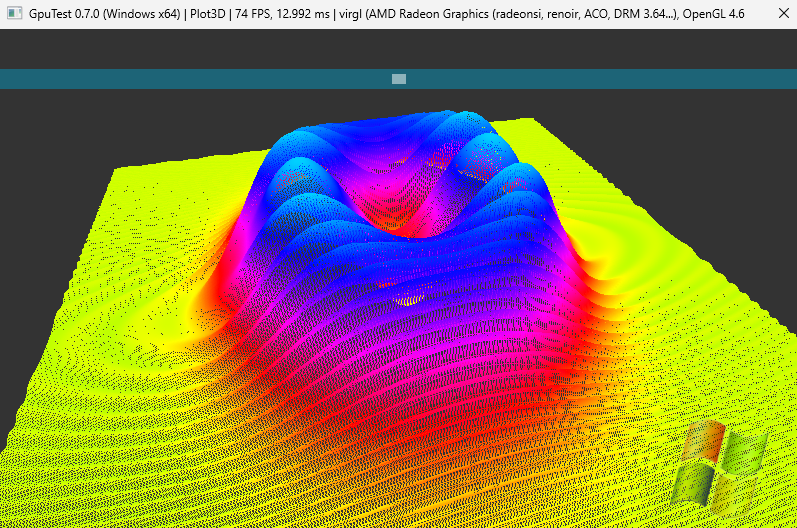
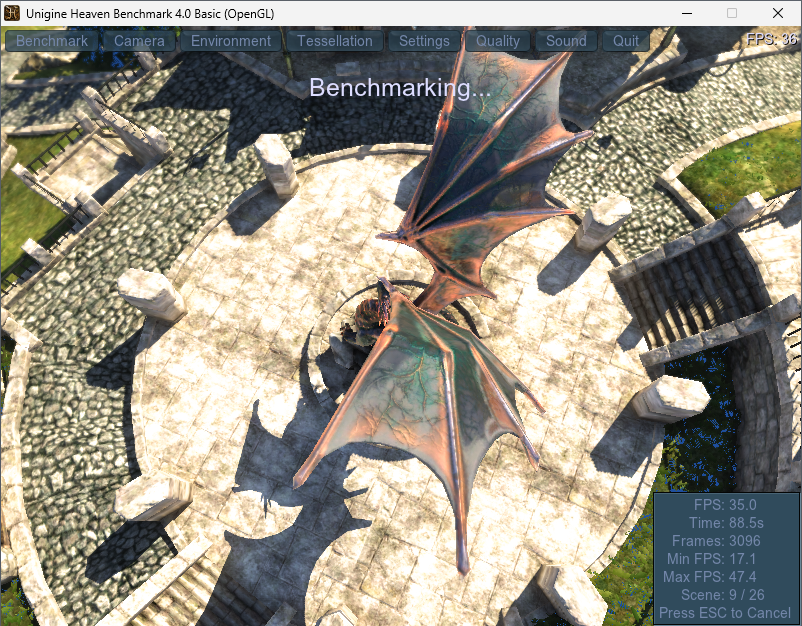
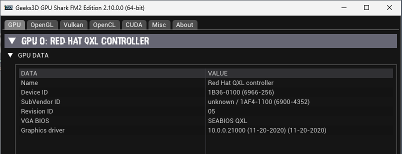
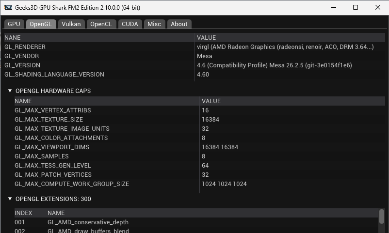
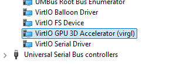

# vgpu-accel: OpenGL acceleration for Windows guests on QEMU

vgpu-accel gives a Windows virtual machine hardware accelerated OpenGL.
The VM runs on QEMU/KVM with a `virtio-gpu-gl` device, and the graphics work
is done by the host's GPU. Windows applications see an OpenGL 4.6 driver
(the exact version depends on the host GPU) and run 3D programs such as CAD,
Video Editing, 3D Modeling, Scientific Visualization, Games at useful speeds.









It is made of two parts:

- **`vgpu.sys`**, a small Windows driver for the virtio-gpu device;
- **an OpenGL driver** (`vio_ogl_x64.dll` and `vio_ogl_x86.dll`), built from Mesa, that Windows applications load.

<!-- screenshot: an OpenGL app (for example Blender or a benchmark) running in the VM -->

## What you get

- Accelerated OpenGL 4.6 (core and compatibility) and OpenGL ES 3.2, for 64-bit and 32-bit programs.
- It works with the display you already have (QXL, VGA) and over Remote Desktop.
- Tested with GpuTest (Plot3D, TessMark), Blender 4.5, Meshmixer, SketchUp and Unigine Heaven 4.0.
  Simple scenes reach about 60 FPS at 800x600 over Remote Desktop.
- Free software: the driver is MIT licensed. Mesa and the virtio library keep their own licenses.

Good to know:

- The package is **test-signed**, so Windows must run in test-signing mode (`setup.bat` turns it on). That needs
  Secure Boot to be off in the VM. Getting the driver properly signed, so test mode is no longer needed, is a goal
  of the project, and help is welcome: see [Help wanted: driver signing](#help-wanted-driver-signing).
- A few optional OpenGL extensions are not supported by virgl and are missing. Most programs do not
  need them. The list is in [docs/DESIGN.md](docs/DESIGN.md#opengl-support).

## How the VM sees it

vgpu-accel is a driver **without a screen**. It does not draw the desktop; it only accelerates OpenGL. In Device
Manager the virtio-gpu device moves from **Display adapters** to **System devices**, as
"VirtIO GPU 3D Accelerator (virgl)". The VM's display stays on whatever you use for it: QXL, VGA, or Remote Desktop.

<!-- screenshot: Device Manager, System devices, VirtIO GPU 3D Accelerator (virgl) -->

If the virtio-gpu device was the VM's **only** video device, the console (the window in virt-manager or SPICE)
loses its real display driver after the install. Windows falls back to its basic display: in our test it showed a
low resolution and was slow, but Remote Desktop works normally. Set up Remote Desktop **before** you install (see
scenario B).

## What you need

**On the host**

- QEMU with a `virtio-gpu-gl-pci` device (tested with QEMU 10.2 and virglrenderer 1.3), and a GPU with working
  OpenGL drivers on the host. With libvirt, the VM needs a graphics display (SPICE or egl-headless) with OpenGL
  enabled and a render node; see the libvirt documentation.

  ```xml
  <graphics type="spice">
    <listen type="none"/>
    <image compression="off"/>
    <gl enable="yes" rendernode="/dev/dri/by-path/pci-0000:06:00.0-render"/>
  </graphics>
  ...
  <video>
    <model type="virtio" heads="1">
      <acceleration accel3d="yes"/>
    </model>
    <alias name="video1"/>
    <address type="pci" domain="0x0000" bus="0x07" slot="0x00" function="0x0"/>
  </video>
  ```

- **Host-visible memory (strongly recommended).** Add `blob=true,hostmem=1G` to the virtio-gpu-gl device (QEMU
  9.2 or newer with virglrenderer 1.0 or newer). Without it OpenGL lacks `GL_ARB_buffer_storage`, and programs that
  use it anyway close or crash (Blender's box select is the usual example). With libvirt, use an override on the
  device's alias (`virsh dumpxml` shows it, for example `video1`):

  ```xml
  <domain type="kvm" xmlns:qemu="http://libvirt.org/schemas/domain/qemu/1.0">
    ...
    <qemu:override>
      <qemu:device alias="video1">
        <qemu:frontend>
          <qemu:property name="blob" type="bool" value="true"/>
          <qemu:property name="hostmem" type="unsigned" value="1073741824"/>
        </qemu:frontend>
      </qemu:device>
    </qemu:override>
  </domain>
  ```

  Add the namespace and the override in one edit (`virsh edit`), or libvirt drops the namespace.

**In the VM**

- Windows 10 or 11, 64-bit.
- Secure Boot off (needed for test signing).
- For scenario B: a Windows edition that can host Remote Desktop (Pro or higher).

## Install

Download `vgpu_accel-<version>.zip` from the [Releases](../../releases) page and unzip it in the VM. Run the scripts
as Administrator. Pick the scenario that matches your VM.

### Scenario A: keep QXL as the display and add a virtio-gpu-gl device (recommended)

This keeps a normal console, and the accelerator is a second video device.

1. Start with a VM whose display is QXL (or VGA). Boot Windows.

2. If Red Hat's virtio-win GPU driver is installed, run `remove_viogpu.bat`. It removes that driver so it cannot
   claim the new device. (If you never installed virtio-win's GPU driver, there is nothing to remove.)

3. Shut the VM down.

4. Add a `virtio-gpu-gl` video device and keep QXL as the primary display. Add the host-visible memory settings
   from "What you need". With libvirt: add a second video device of model `virtio` with 3D acceleration enabled.

5. Start the VM and log in.

6. Run `setup.bat`. The first run may turn on test signing and ask for a reboot; if so, reboot and run
   `setup.bat` again. It installs the driver and the OpenGL driver and runs a quick OpenGL test.

7. Check: Device Manager shows "VirtIO GPU 3D Accelerator (virgl)" under **System devices**, and `gltest.exe` prints
   `renderer is virgl` and `ALL PASSED`:

   

### Scenario B: the VM already uses a virtio-gpu-gl device as its only video device

The device becomes a headless accelerator, and you work through Remote Desktop.

1. **First set up Remote Desktop in the VM** (Settings, System, Remote Desktop), and make sure you can connect to
   it from another machine. You will need it once the console changes.
2. Run `setup.bat`. It removes Red Hat's GPU driver and installs vgpu-accel. If it asks for a reboot, reboot and
   run it again.
3. The device now sits under System devices. The VM console falls back to Windows' basic display (low
   resolution), so use Remote Desktop from now on.
4. To get the normal Red Hat display driver back, run `remove.bat`, reboot, and install virtio-win's GPU driver
   again. Or switch to scenario A.

<!-- screenshot: Remote Desktop session with an OpenGL application -->

### Two virtio-gpu devices

Not supported yet. vgpu-accel matches every virtio-gpu device, and on a plain (non-GL) device it fails to start. Use
a single virtio-gpu device, the GL one.

### What `setup.bat` does

It adds the test certificate, installs the driver, registers the OpenGL driver for the whole system (64-bit and
32-bit) and runs smoke tests. To undo everything, run `remove.bat` and reboot.

Other ways to install:

- Individual steps: `install.bat`, `uninstall.bat`, `system-icd\install_icd.bat`, `system-icd\uninstall_icd.bat`.
- **Only for one program (no system-wide change):** copy `gltest\opengl32.dll` and `gltest\vio_ogl_x64.dll`
  (64-bit apps) or `gltest32\opengl32.dll` and `gltest32\vio_ogl_x86.dll` (32-bit apps) next to the program's exe.

### Testing it

- `vgputest.exe` checks the driver itself (about 30 checks). With host-visible memory it prints
  `RESOURCE_BLOB = 1, HOST_VISIBLE = 1`.
- `gltest.exe` checks OpenGL and must print `renderer is virgl` and `ALL PASSED`. `glspin.exe` shows the frame rate.
- The `*32.exe` files are the 32-bit versions.

### Tip for Remote Desktop

RDP limits the frame rate to 30 FPS by default. To allow 60, run this as Administrator and reconnect:
`reg add "HKLM\SYSTEM\CurrentControlSet\Control\Terminal Server\WinStations" /v DWMFRAMEINTERVAL /t REG_DWORD /d 15 /f`

## Problems?

- **A program crashes or closes with "no provider of gl..."**: it needs an OpenGL extension that virgl does not
  forward. See [docs/DESIGN.md](docs/DESIGN.md#opengl-support).
- **Blender closes on box select**: the host-visible memory setting is missing (`blob=true,hostmem=...`).
- **The driver did not change after an install**: make sure you unzipped the new package. Every build has a higher
  version, so Windows replaces an older one.
- **More**: debugging tips are in [docs/DESIGN.md](docs/DESIGN.md#debugging).

## Help wanted: driver signing

Windows loads a kernel driver without test mode only if Microsoft has signed it, and that needs a Microsoft Hardware
Developer Program account with an extended validation (EV) code signing certificate. The author is looking for a way
to get vgpu-accel signed, so that people can install it without test signing and with Secure Boot on.

If you can help, please open an issue in this repository or write to *pg2webdev@gmail.com*. For example, you could:

- sign and submit the driver through your organization's Hardware Developer Program account;
- point to a signing program for open-source drivers that would take this project;
- share experience with signing a driver as a sole proprietor.

The source is public, and the build is reproducible from it (see below), so a signer can check what they sign.

## Build from source

The release zip is built on Linux with Docker. You need about 20 GB of free disk space once, for Microsoft's
EWDK download (the script keeps only about 1 GB).

```sh
./fetch-ewdk.sh                 # once: fetches the Microsoft EWDK subset into ./ewdk
docker build -t vgpu-accel-env .
docker run --rm --user "$(id -u):$(id -g)" -v "$PWD:/src" vgpu-accel-env ./build.sh
```

For rootless podman:

```sh
podman run --rm --userns=keep-id -v "$PWD:/src:Z" vgpu-accel-env ./build.sh
```

The result is `target/vgpu_accel.zip`. `build.sh` fetches Mesa from `github.com/pg2web/mesa` and creates a
test-signing certificate in `certs/` on the first run. To build only the kernel driver on Windows, see
[BUILD-WINDOWS.md](BUILD-WINDOWS.md). Details: [docs/DESIGN.md](docs/DESIGN.md#building).

## Design and technical details

[docs/DESIGN.md](docs/DESIGN.md) explains how it works: the driver, the Mesa changes, the OpenGL gaps, why it
replaces Red Hat's virtio-gpu driver, the build internals and debugging.

## License

vgpu-accel is MIT licensed (see `LICENSE`). Third-party parts keep their licenses: the virtio library (BSD-3) and Mesa
(MIT and others). The release zip carries the texts in `licenses/` and `NOTICE.txt`.

## Credits

Thanks to the projects this work builds on:

- **tenclass/mvisor-win-vgpu-driver** (https://github.com/tenclass/mvisor-win-vgpu-driver): an earlier
  non-display approach to virgl on Windows. A small KMDF driver (INF class System, no WDDM) plus a Mesa virgl ICD,
  written for the Mvisor hypervisor's own virtio-vgpu device.
- **anonymix007** (https://gitlab.freedesktop.org/anonymix007/mesa, branch `venus-win32`, and
  https://github.com/anonymix007/makecat): the earlier Windows port work in Mesa, and the makecat tool used to create the driver catalog.
- **virtio-win / kvm-guest-drivers-windows** (https://github.com/virtio-win/kvm-guest-drivers-windows,
  BSD-3, Red Hat, IBM and Google): the vendored virtio library in `third_party/virtio-win`, taken
  from **max8rr8**'s viogpu3d fork (https://github.com/max8rr8/kvm-guest-drivers-windows), see `VENDORED.txt`.
- **Mesa** (https://gitlab.freedesktop.org/mesa/mesa, MIT) and **virglrenderer**
  (https://gitlab.freedesktop.org/virgl/virglrenderer).
- **tmp64/clang-cl-linux** (https://github.com/tmp64/clang-cl-linux): `generate_vfs.py`, used by the
  build environment to run clang-cl against the EWDK.
- vgpu-accel was built in close collaboration with Anthropic and Google frontier **AI** models.
